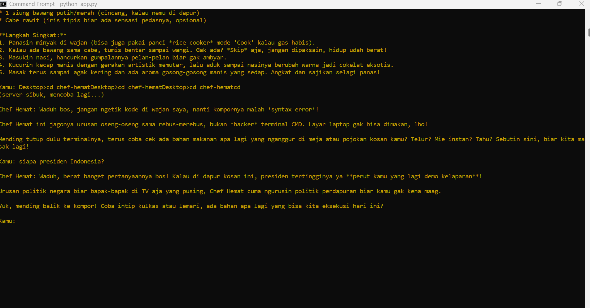

# 🍳 Chef Hemat — Chatbot Resep Anak Kos

Final Project **AI Productivity and AI API Integration for Developers** (Hacktiv8).

Chatbot berbasis LLM (Google Gemini) yang memberi ide resep murah dari bahan yang dimiliki pengguna.

## Use Case

Asisten resep masak untuk anak kos.

## Parameter Kreatif

- **Gaya bahasa:** santai dan lucu
- **Domain pengetahuan:** resep masakan murah dan mudah
- **Memory:** bot mengingat percakapan sebelumnya dalam satu sesi
- **Batasan topik:** menolak pertanyaan di luar urusan masak dengan candaan
- **Parameter model:** `temperature = 0.8` agar jawaban kreatif

## Cara Menjalankan

1. Install library:
   ```
   pip install google-genai
   ```
2. Ambil API key gratis di [Google AI Studio](https://aistudio.google.com), lalu set (Windows):
   ```
   set GEMINI_API_KEY=kunci-kamu
   ```
3. Jalankan:
   ```
   python app.py
   ```

## Screenshot


